# JAARK

A Bluetooth tank-style RC car with its own handheld controller, built on two STM32F446 Nucleo boards. JAARK carries a Colpitts oscillator metal detector, an ultrasonic range finder, headlights and a buzzer, and streams live telemetry back to an LCD on the controller.

Built by Team 28 for ENEL 300 at the University of Calgary (Winter 2026): Affaan Aamir, Jonart Bajraktari, Rohan Friesen, Karim Khodr and Abdul Qureshi. The name comes from our first initials.

<p align="center">
  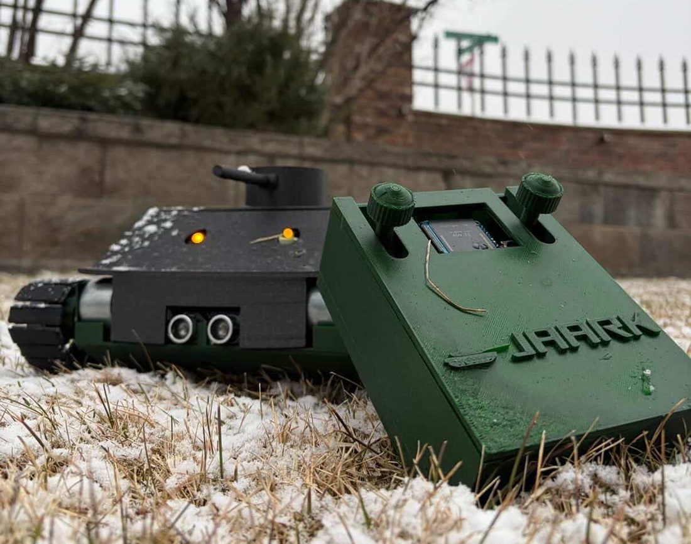
</p>

## Contents

- [Who did what](#who-did-what)
- [System overview](#system-overview)
- [Hardware](#hardware)
- [Firmware](#firmware)
- [Pin map](#pin-map)
- [Repository layout](#repository-layout)
- [Building and flashing](#building-and-flashing)
- [Limitations and next steps](#limitations-and-next-steps)

## Who did what

| Area | Owner |
| --- | --- |
| All firmware on both boards: Bluetooth link, Fletcher-16 checksums, watchdog, driving, sensors, metal detection algorithm, LCD driver and UI | Jonart Bajraktari |
| Vehicle PCB (KiCad, this repo) | Jonart Bajraktari |
| Colpitts oscillator for the metal detector | Jonart Bajraktari |
| Controller PCB (Altium), chassis, drivetrain and enclosures | Teammates |

## System overview

The controller reads two joysticks and a headlight button, packs them into a 4 byte packet and sends it to the car over a pair of HC-05 modules. The car drives its tracks from that packet and replies with a 7 byte packet carrying the ultrasonic distance and the metal detector flag. Both directions are checked with a Fletcher-16 checksum and both boards run a watchdog on the link.

<p align="center">
  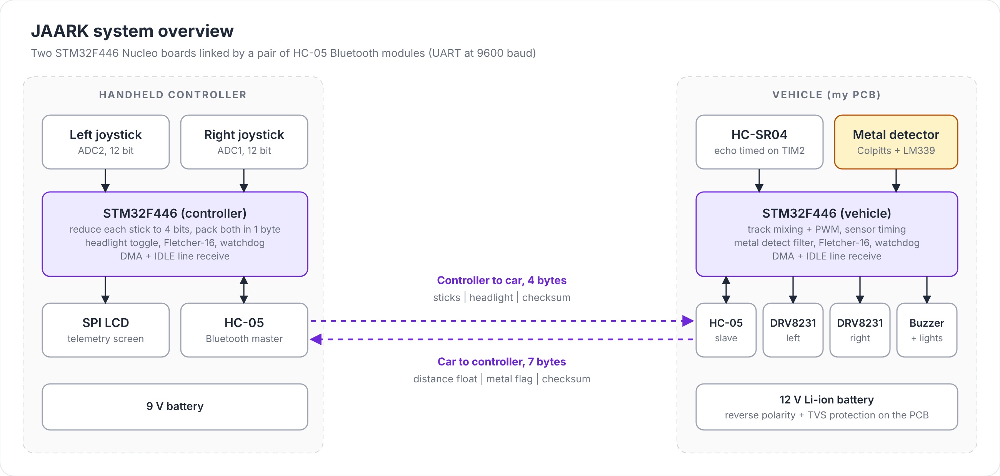
</p>

## Hardware

### Vehicle PCB

The vehicle board is a KiCad carrier for the Nucleo. It holds the battery protection, two DRV8231 H-bridge drivers for the 12 V track motors, the HC-05 module, test points and connectors for the metal detector, ultrasonic sensor and motors.

<p align="center">
  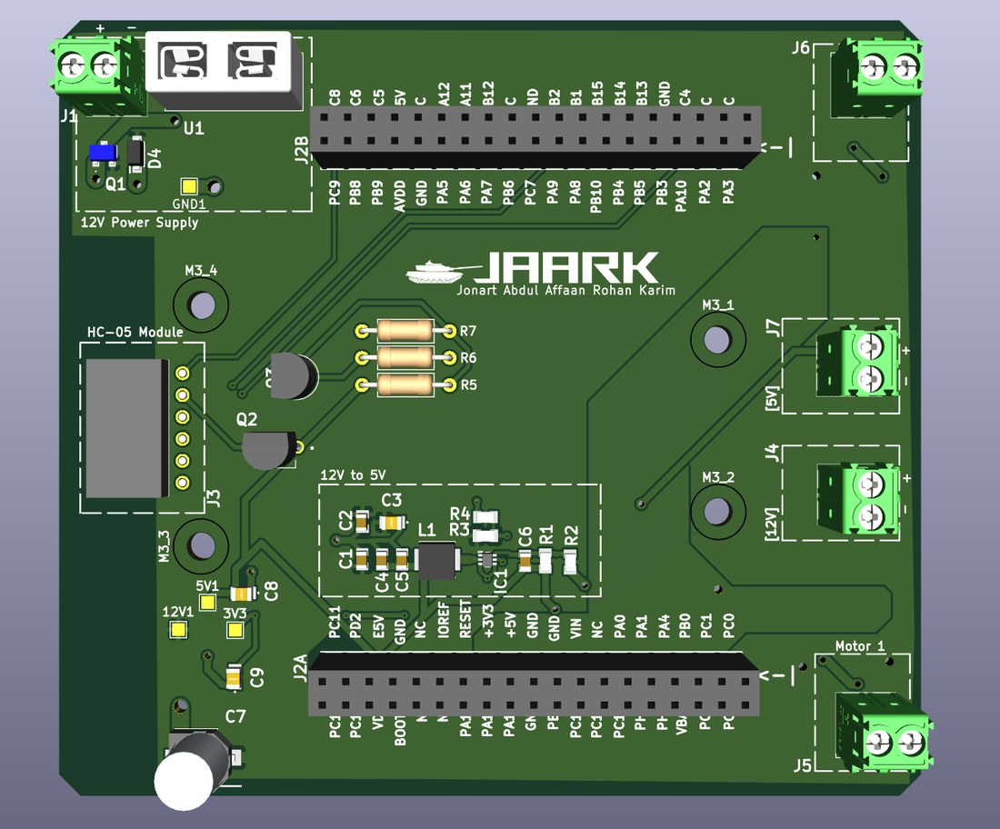
  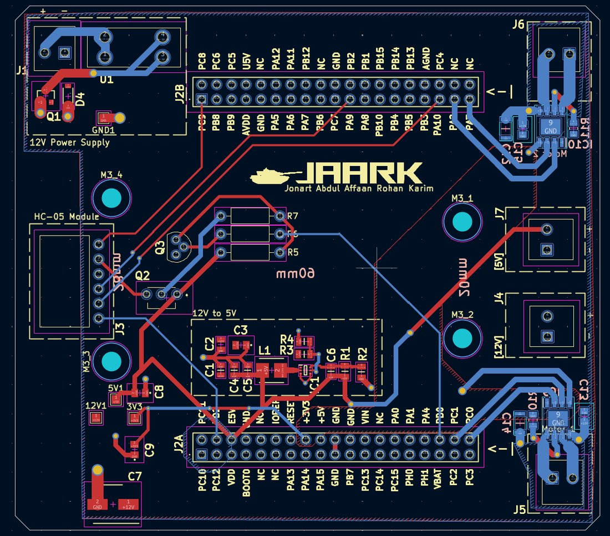
</p>

- **Battery protection:** a P-channel MOSFET blocks a reversed battery, a 15 V TVS diode clamps transients and a 10 µF capacitor provides bulk decoupling on the 12 V rail
- **Motor drivers:** two DRV8231 (4.5 V to 33 V, 3.7 A peak), one per track. A 0.2 Ω sense resistor on each caps the output at about 1.6 A, above the 1.2 A stall current of the Cytron SPG30E-270K motors
- **Trace widths:** 2 mm for the battery and motor current paths (IPC-2221), 0.75 mm for 5 V and 0.5 mm for 3.3 V
- **Thermal and noise:** pours on GND and +12 V, driver thermal pads tied to the ground plane, high-current parts on the perimeter and HC-05 routing kept away from the drivers

<p align="center">
  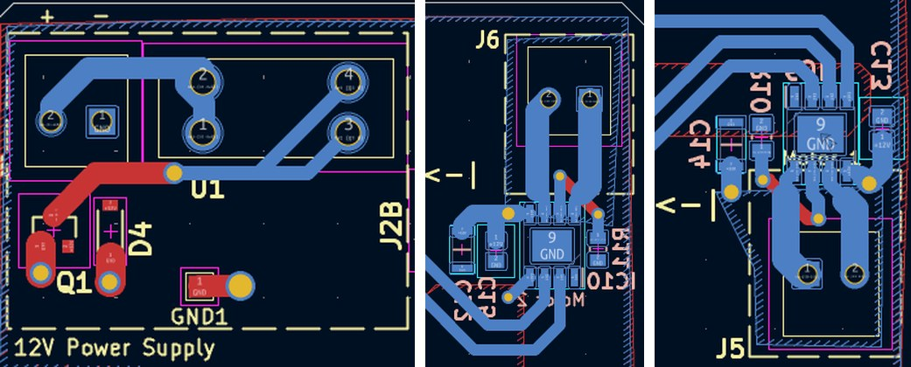
</p>

<p align="center">
  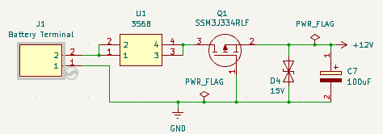
  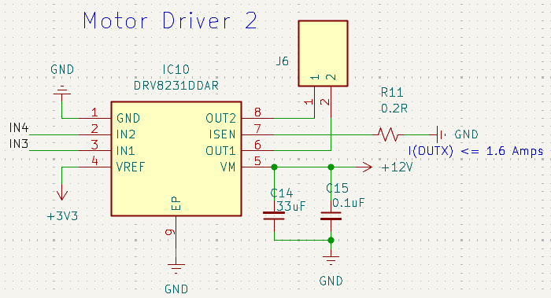
</p>

The 12 V 2800 mAh Li-ion pack is rated for 3 A continuous, which covers both motors at stall plus about 0.5 A of logic. Worst case runtime:

$$t = \frac{2800\ \text{mAh}}{2(1.2\ \text{A}) + 0.5\ \text{A}} \approx 58\ \text{min}$$

In practice the motors start to sag at around 20% charge, so a full run is closer to 45 minutes.

### Colpitts oscillator metal detector

The detector is a common-emitter Colpitts oscillator with a 22 mH search coil mounted under the chassis. The tank is the coil in parallel with two 1 nF capacitors in series:

$$f_0 = \frac{1}{2\pi\sqrt{L\,\frac{C_1 C_2}{C_1 + C_2}}} = \frac{1}{2\pi\sqrt{22\ \text{mH} \cdot 0.5\ \text{nF}}} \approx 48\ \text{kHz}$$

Metal near the coil changes its inductance and moves that frequency:

$$\frac{\Delta f}{f_0} \approx -\frac{1}{2}\,\frac{\Delta L}{L}$$

The faint sine output is AC coupled (5 nF) onto a 2.5 V bias, compared against 2.5 V by an LM339 and level shifted to a clean 3.3 V square wave by an NPN stage. The STM32 then times each rising edge with a 32-bit input capture timer, so the analog side never needs an amplitude detector or a long conditioning chain.

<p align="center">
  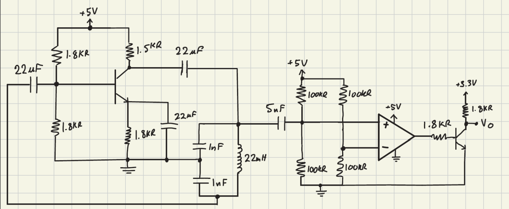
</p>

The circuit is the most sensitive part of the car. Supply noise, parasitics and nearby copper all pull the frequency, so it is kept away from the motors, battery and main PCB, and the coil is glued and taped down so vibration does not read as metal.

## Firmware

Everything is C on the STM32 HAL. Time-critical work (UART, sensor timing, watchdog) runs in hardware peripherals and interrupts, and the main loop handles decisions and outputs.

### Bluetooth link and checksums

- Two HC-05 modules in a master and slave pair over UART at 9600 baud
- Receive runs on DMA with IDLE line detection (`HAL_UARTEx_ReceiveToIdle_DMA`) and the half-transfer interrupt turned off, so one callback fires per frame
- Every packet ends in a Fletcher-16 checksum. A frame that fails is dropped and the receiver enters **hunt mode**: it shifts its buffer left by one byte and asks DMA for one more byte until the checksum lines up again

<p align="center">
  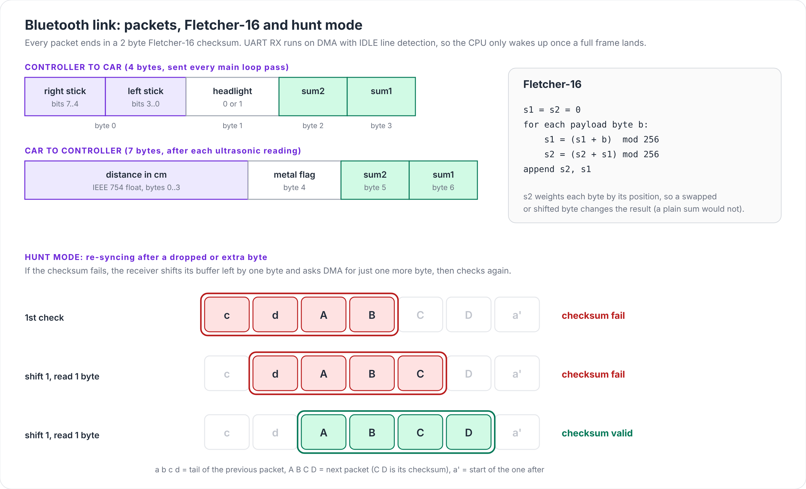
</p>

### Watchdog

A 16-bit timer (TIM3) runs on both boards and only a packet with a valid checksum resets it. If it overflows, the car sets all four motor PWM channels to zero, aborts and cleans up the UART, re-arms DMA and keeps pinging until a valid packet arrives. The controller shows a red watchdog screen with a reconnect animation over the same period. This was tested by cutting the link in several different ways and checking that the car always stopped and recovered.

<p align="center">
  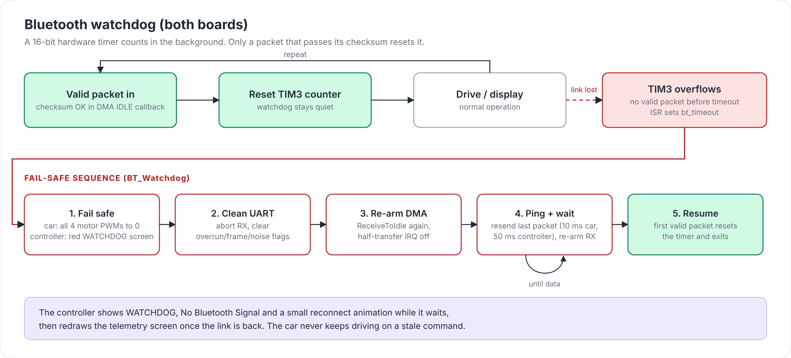
</p>

### Driving

Each stick controls one track, like a real tank. The controller sends each stick as 4 bits, the car smooths the value with an exponential filter, applies a deadband around centre and maps the rest to 40% to 90% duty on one of the two DRV8231 inputs. PWM runs at 1 kHz from TIM8, TIM10 and TIM11.

<p align="center">
  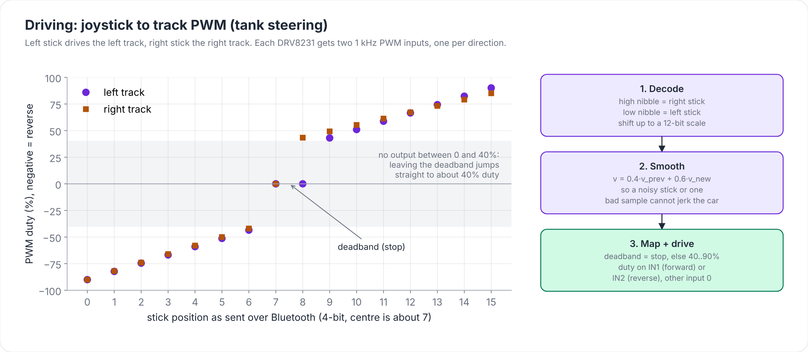
</p>

### Ultrasonic distance

The car fires a 10 µs trigger pulse at the HC-SR04, then timestamps both edges of the echo on a 32-bit timer through an EXTI interrupt. Distance follows from the round trip time at 343 m/s:

$$d = \frac{v\,t}{2}$$

The reading is packed as a float into the 7 byte reply, and the controller smooths it before display.

### Metal detection algorithm

TIM5 captures each rising edge of the comparator output, and the gap between captures gives the frequency, $f = 84\ \text{MHz} / \Delta\text{ticks}$. At boot the firmware calibrates a baseline over 500 samples. After that it keeps two exponential moving averages of the frequency, a fast one ($\alpha = 0.2$) and a slow one ($\alpha = 0.085$). Slow drift moves both averages together, while metal moves the fast one first. When the fast average leads the slow one by more than 200 Hz, the car sounds the buzzer (2 kHz PWM on TIM12), sets the metal flag in its next packet and holds off for 0.8 s on TIM4.

<p align="center">
  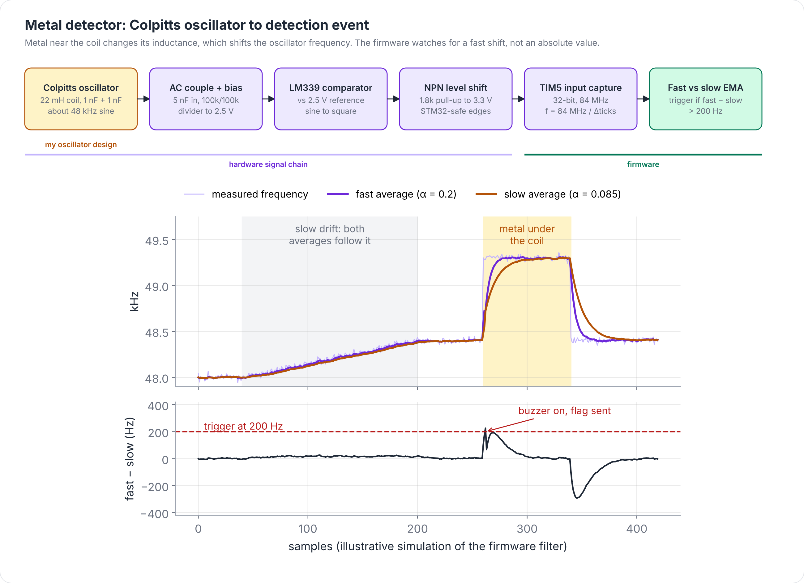
</p>

### Controller display

The controller drives its SPI LCD with a custom ILI9341 driver that only redraws the regions that changed, which keeps CPU time free for the link. The screen shows headlight state, distance, both stick levels as bars, metal detection alerts and the watchdog screen. Font tables come from an open-source library, and `cnv_to_bit.py` converts PNG glyphs and images into raw bitmaps.

<p align="center">
  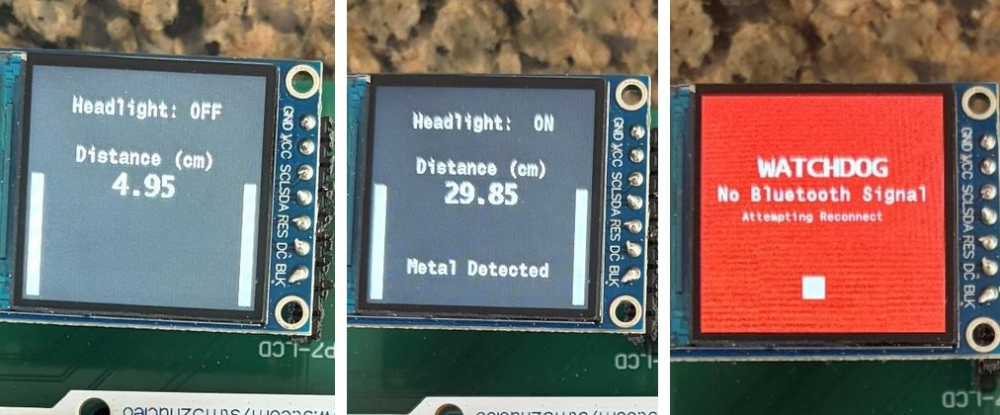
</p>

## Pin map

**Vehicle (STM32F446, `STM32/PCB_MOTOR_STM`)**

| Function | Pin | Peripheral |
| --- | --- | --- |
| HC-05 TX / RX | PA9 / PA10 | USART1 |
| Left track forward / reverse | PB8 / PB9 | TIM10 CH1 / TIM11 CH1 |
| Right track forward / reverse | PC8 / PC6 | TIM8 CH3 / TIM8 CH1 |
| Metal detector input | PA0 | TIM5 CH1 input capture |
| Buzzer | PB14 | TIM12 CH1 |
| HC-SR04 trigger / echo | PB4 / PB10 | GPIO / EXTI10 + TIM2 |
| Headlights | PB7 | GPIO |

**Controller (STM32F446, `STM32/STM32_CONTROLLER`)**

| Function | Pin | Peripheral |
| --- | --- | --- |
| HC-05 TX / RX | PA9 / PA10 | USART1 |
| Right stick / left stick | PA0 / PC4 | ADC1 IN0 / ADC2 IN14 |
| Joystick buttons (headlight toggle) | PC3, PB4 | GPIO |
| LCD SCK / MOSI | PB13 / PB15 | SPI2 |

## Repository layout

```
JAARK/
├── PCB/JAARK_PCB_MOTOR/      KiCad 9 vehicle board: schematic, layout, BOM, Gerbers in production/
├── STM32/PCB_MOTOR_STM/      vehicle firmware (CubeMX project with CMake presets)
├── STM32/STM32_CONTROLLER/   controller firmware (STM32CubeIDE project)
├── cnv_to_bit.py             PNG to raw bitmap converter for the LCD
└── docs/images/              figures used in this README
```

## Building and flashing

1. Open `STM32/PCB_MOTOR_STM` or `STM32/STM32_CONTROLLER` in STM32CubeIDE (File > Import > Existing Projects). The vehicle project also builds with CMake and the GNU Arm toolchain:
   ```bash
   cd STM32/PCB_MOTOR_STM
   cmake --preset Debug
   cmake --build --preset Debug
   ```
2. Flash each Nucleo over its onboard ST-LINK.
3. Pair the two HC-05 modules as master and slave at 9600 baud before the first run.
4. Power the car with the detector coil away from metal. It calibrates the detector for about 5 seconds, then waits for the first packet from the controller.

## Limitations and next steps

- The onboard 12 V to 5 V buck regulator was inconsistent, so the final build takes 5 V from the Nucleo regulator instead. A respin would fix the regulator layout.
- Most firmware lives in one main loop with flag polling. Splitting each subsystem into its own module, or moving to a state machine, would make it easier to extend.
- The link has no acknowledgements or sequence numbers. The checksum and watchdog catch bad or missing data, but they cannot tell a late packet from a fresh one.
